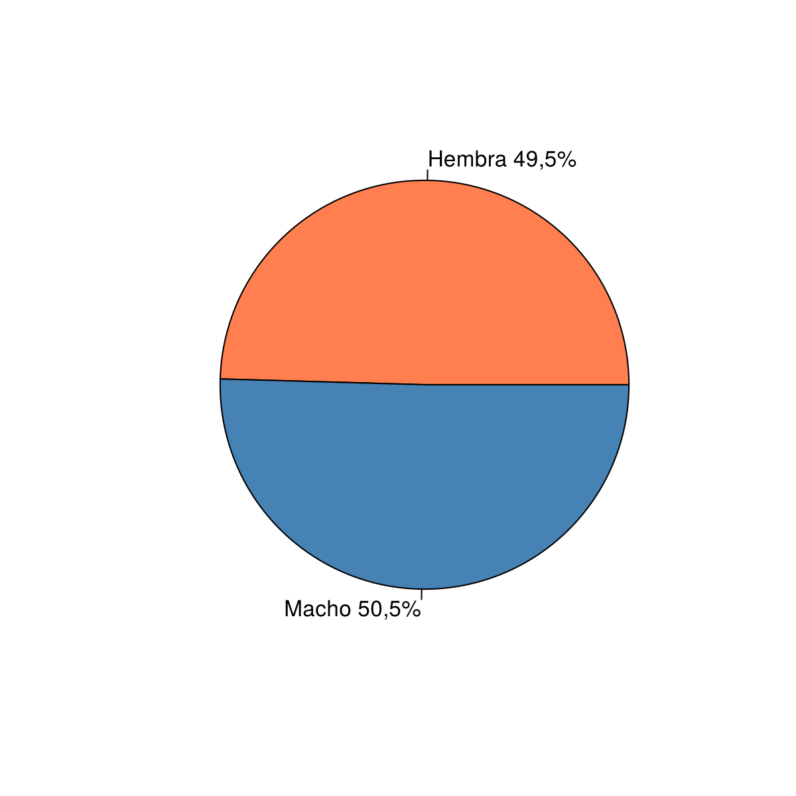
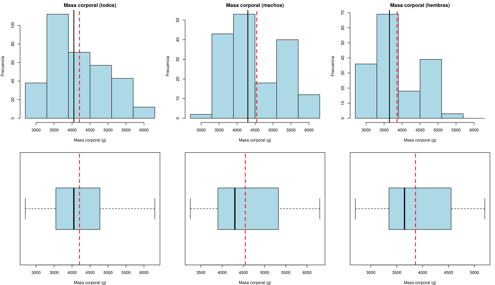
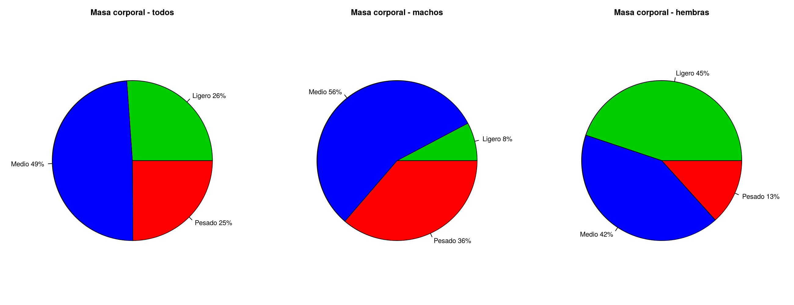
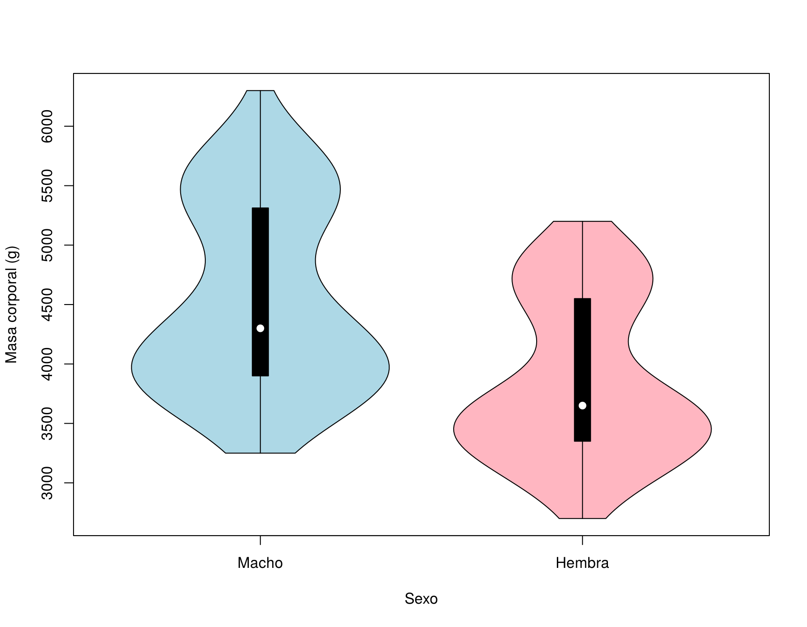
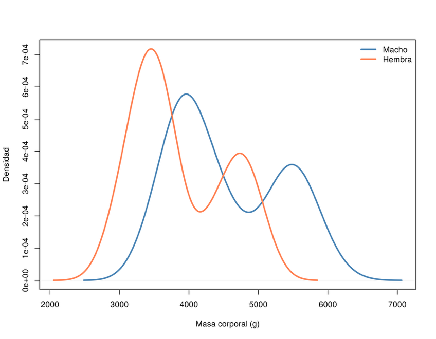
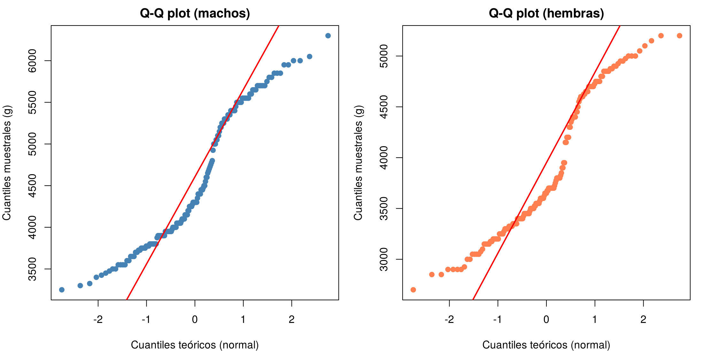
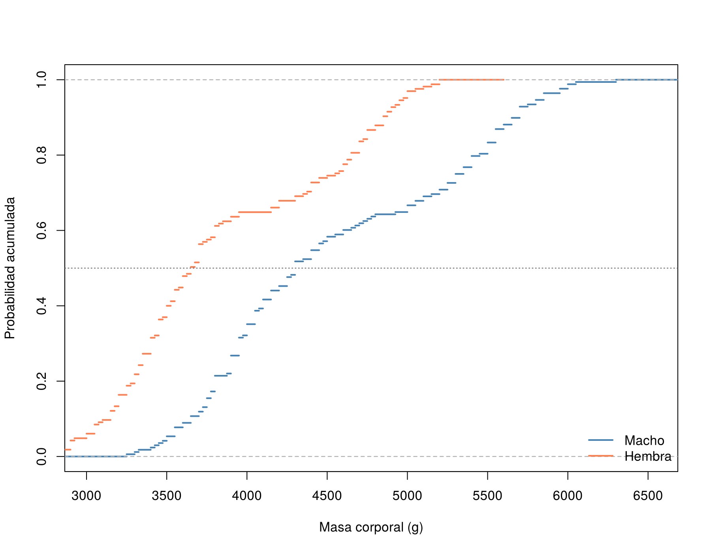
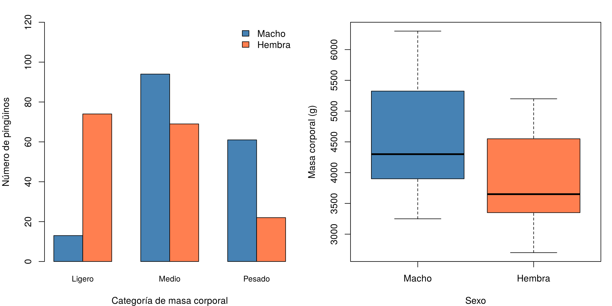
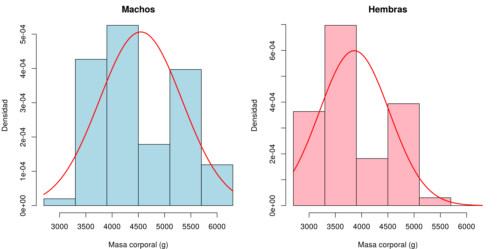
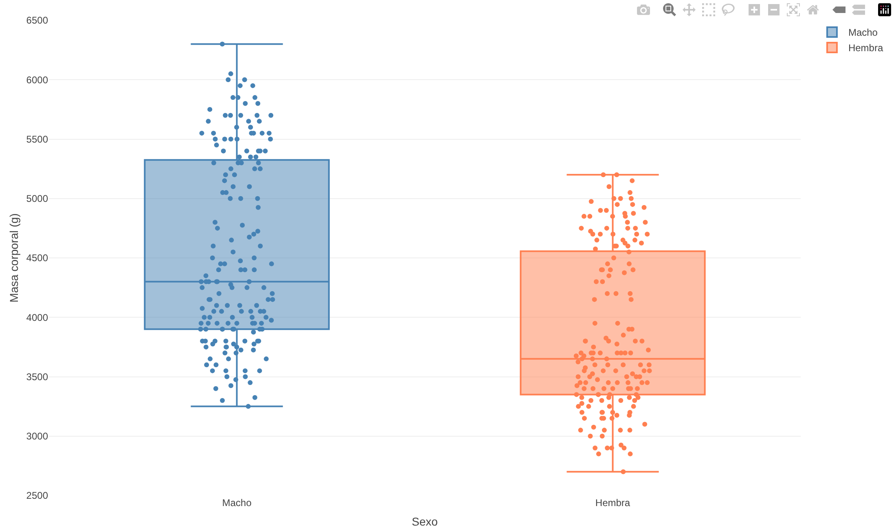

# Análisis estadístico descriptivo de la masa corporal de los pingüinos del archipiélago Palmer según el sexo

**PL1 – Informe de estadística descriptiva** · Estadística · Grado en Ingeniería de Computadores
Escuela Politécnica Superior · Universidad de Alcalá · Curso 2026-2027

**Autora:** Joselin Yasbel Olivares Soto · **Grupo de laboratorio:** 1B2 · **Profesor:** José R. Hilera

---

### Contenido del repositorio

| Archivo | Descripción |
|---|---|
| `README.md` | Este informe completo en formato Markdown |
| `PL1_Informe_Pinguinos.pdf` | El mismo informe en PDF |
| `PL1_pinguinos.R` | Script de R con todos los cálculos, tablas y figuras |
| `PL1_pinguinos.Rproj` | Proyecto de RStudio |
| `penguins_PL1_es.csv` | Datos utilizados (333 pingüinos) |
| `imagenes/` | Las 10 figuras del informe |

Para reproducir los resultados: abrir `PL1_pinguinos.Rproj` en RStudio, abrir `PL1_pinguinos.R` y ejecutarlo (Ctrl+A y después Run). Se necesitan los paquetes `e1071`, `vioplot` y `plotly`.

---

## 1. Introducción

### 1.1 Contexto

El programa de investigación Palmer LTER (Palmer Station Long Term
Ecological Research) realiza desde hace varias décadas un seguimiento
ecológico de la fauna del archipiélago Palmer, en la Antártida. Entre
las especies estudiadas se encuentran tres especies de pingüinos:
Adelia, Barbijo y Papúa, que habitan en las islas Biscoe, Dream y
Torgersen. Como parte de dicho programa, entre los años 2007 y 2009 se
realizaron mediciones físicas individuales a una muestra de pingüinos
adultos, registrando variables como la especie, la isla, las dimensiones
del pico, la longitud de la aleta, la masa corporal y el sexo de cada
ejemplar.

### 1.2 Objetivo

El objetivo de la investigación llevada a cabo ha sido “realizar un
análisis estadístico descriptivo de la masa corporal de los pingüinos
estudiados por el programa Palmer LTER en el archipiélago Palmer
(Antártida), comprobando si existen diferencias en dicha variable entre
los pingüinos de sexo macho y los de sexo hembra”.

### 1.3 Alcance

La investigación se limita a los pingüinos observados por el programa
Palmer LTER entre los años 2007 y 2009 en las islas Biscoe, Dream y
Torgersen, y se ha utilizado una muestra de 333 pingüinos de los 344
inicialmente registrados, tras eliminar 11 registros que presentaban
valores no disponibles en las columnas de sexo o de masa corporal.

## 2. Metodología

### 2.1 Origen de los datos

Se ha trabajado con un archivo denominado “penguins_PL1_es.csv”,
elaborado a partir del conjunto de datos abiertos “Palmer Archipelago
(Antarctica) Penguin Data”, publicado en el catálogo de datos abiertos
Kaggle y disponible en la siguiente dirección web:

*https://www.kaggle.com/datasets/parulpandey/palmer-archipelago-antarctica-penguin-data*

El archivo original contiene los registros recogidos por el programa
Palmer LTER entre los años 2007 y 2009. Sobre el archivo original se han
realizado las siguientes operaciones de organización de datos:
traducción al español de los nombres de las columnas y de los valores de
las variables cualitativas (especie, isla y sexo), y eliminación de los
11 registros con valores no disponibles (NA) en las columnas de sexo o
de masa corporal, resultando un archivo final de 333 filas válidas. Cada
fila del archivo corresponde a un pingüino adulto e incluye su especie,
la isla en la que fue observado, la longitud y la profundidad de su pico
(en milímetros), la longitud de su aleta (en milímetros), su masa
corporal (en gramos), su sexo y el año de la observación.

### 2.2 Herramientas

Se han procesado los datos utilizando la aplicación RStudio para macOS,
versión 2026.09.0, con R versión 4.6.1, y los paquetes de funciones:
“e1071” para calcular los coeficientes de asimetría y de apuntamiento
(curtosis), “vioplot” para el diagrama de violín, y “plotly” para el
diagrama interactivo. El resto de diagramas se han generado con las
funciones gráficas del paquete base de R. Como actividad adicional, el
informe se ha publicado también en formato Markdown en GitHub, en la
dirección: este mismo repositorio.

### 2.3 Diseño

El resumen del diseño es el siguiente:

**Variables estadísticas:**

Se ha analizado la variable estadística “Masa corporal del pingüino”,
que representa el peso total, expresado en gramos, de un pingüino adulto
registrado por los investigadores del programa Palmer LTER en el momento
de su captura y medición en el campo entre los años 2007 y 2009. Es de
tipo cuantitativo continuo, con valores positivos comprendidos entre
2.700 y 6.300 gramos.

También se ha utilizado la variable estadística “Sexo del pingüino”, de
tipo cualitativo, con valores “Macho” o “Hembra”.

**Población:** 344 pingüinos.

Cada individuo de la población representa un pingüino adulto, de la
especie Adelia, Barbijo o Papúa, observado y medido por el programa de
investigación Palmer LTER en el archipiélago Palmer (Antártida) entre
los años 2007 y 2009.

**Muestra:** 333 pingüinos, de los cuales 168 son de sexo macho y 165 de
sexo hembra.

Organización de datos: se han eliminado del archivo original los 11
registros que presentaban valores no disponibles (NA) en la columna de
sexo o en la de masa corporal, resultando un total de 333 observaciones
válidas. No se ha realizado ninguna fusión con otros archivos; se trata
de una única tabla de datos.

## 3. Resultados

### 3.1 Muestras

La muestra completa de 333 valores de masa corporal (en gramos),
ordenados de menor a mayor, es la siguiente:

```text
2700 2850 2850 2900 2900 2900 2900 2925 3000 3000 3050 3050 3050 3050
3075 3100 3150 3150 3150 3150 3175 3175 3200 3200 3200 3200 3200 3250
3250 3250 3250 3250 3275 3300 3300 3300 3300 3300 3325 3325 3325 3325
3325 3350 3350 3350 3350 3350 3400 3400 3400 3400 3400 3400 3400 3400
3425 3425 3450 3450 3450 3450 3450 3450 3450 3450 3475 3475 3500 3500
3500 3500 3500 3500 3500 3525 3525 3550 3550 3550 3550 3550 3550 3550
3550 3550 3575 3600 3600 3600 3600 3600 3600 3600 3625 3650 3650 3650
3650 3650 3650 3675 3675 3700 3700 3700 3700 3700 3700 3700 3700 3700
3700 3725 3725 3725 3750 3750 3750 3750 3750 3775 3775 3775 3775 3800
3800 3800 3800 3800 3800 3800 3800 3800 3800 3800 3800 3825 3850 3875
3900 3900 3900 3900 3900 3900 3900 3900 3900 3900 3950 3950 3950 3950
3950 3950 3950 3950 3950 3950 3975 4000 4000 4000 4000 4000 4050 4050
4050 4050 4050 4050 4075 4100 4100 4100 4100 4150 4150 4150 4150 4150
4150 4200 4200 4200 4200 4200 4250 4250 4250 4250 4275 4300 4300 4300
4300 4300 4300 4300 4300 4350 4350 4375 4400 4400 4400 4400 4400 4400
4400 4400 4450 4450 4450 4450 4450 4475 4500 4500 4500 4550 4550 4575
4600 4600 4600 4600 4600 4625 4625 4650 4650 4650 4650 4675 4700 4700
4700 4700 4700 4700 4725 4725 4750 4750 4750 4750 4750 4775 4800 4800
4800 4850 4850 4850 4850 4875 4875 4900 4900 4925 4925 4950 4950 4975
5000 5000 5000 5000 5000 5000 5050 5050 5050 5100 5100 5100 5150 5150
5200 5200 5200 5200 5250 5250 5250 5300 5300 5300 5300 5350 5350 5350
5400 5400 5400 5400 5400 5450 5500 5500 5500 5500 5500 5550 5550 5550
5550 5550 5550 5600 5600 5650 5650 5650 5700 5700 5700 5700 5700 5750
5800 5800 5850 5850 5850 5950 5950 6000 6000 6050 6300
```

La muestra de 168 valores de masa corporal de los pingüinos de sexo
macho es la siguiente:

```text
3250 3300 3325 3400 3425 3450 3475 3500 3500 3550 3550 3550 3550 3600
3600 3650 3650 3650 3700 3700 3725 3725 3750 3750 3750 3750 3775 3775
3775 3800 3800 3800 3800 3800 3800 3800 3875 3900 3900 3900 3900 3900
3900 3900 3900 3950 3950 3950 3950 3950 3950 3950 3950 3975 4000 4000
4000 4000 4000 4050 4050 4050 4050 4050 4050 4075 4100 4100 4100 4100
4150 4150 4150 4150 4200 4200 4250 4250 4250 4250 4275 4300 4300 4300
4300 4300 4300 4350 4400 4400 4400 4400 4450 4450 4450 4475 4500 4500
4550 4600 4600 4650 4675 4700 4725 4750 4775 4800 4925 5000 5000 5000
5050 5050 5100 5100 5150 5200 5200 5250 5250 5250 5300 5300 5300 5300
5350 5350 5350 5400 5400 5400 5400 5400 5450 5500 5500 5500 5500 5500
5550 5550 5550 5550 5550 5550 5600 5600 5650 5650 5650 5700 5700 5700
5700 5700 5750 5800 5800 5850 5850 5850 5950 5950 6000 6000 6050 6300
```

La muestra de 165 valores de masa corporal de los pingüinos de sexo
hembra es la siguiente:

```text
2700 2850 2850 2900 2900 2900 2900 2925 3000 3000 3050 3050 3050 3050
3075 3100 3150 3150 3150 3150 3175 3175 3200 3200 3200 3200 3200 3250
3250 3250 3250 3275 3300 3300 3300 3300 3325 3325 3325 3325 3350 3350
3350 3350 3350 3400 3400 3400 3400 3400 3400 3400 3425 3450 3450 3450
3450 3450 3450 3450 3475 3500 3500 3500 3500 3500 3525 3525 3550 3550
3550 3550 3550 3575 3600 3600 3600 3600 3600 3625 3650 3650 3650 3675
3675 3700 3700 3700 3700 3700 3700 3700 3700 3725 3750 3775 3800 3800
3800 3800 3800 3825 3850 3900 3900 3950 3950 4150 4150 4200 4200 4200
4300 4300 4350 4375 4400 4400 4400 4400 4450 4450 4500 4550 4575 4600
4600 4600 4625 4625 4650 4650 4650 4700 4700 4700 4700 4700 4725 4750
4750 4750 4750 4800 4800 4850 4850 4850 4850 4875 4875 4900 4900 4925
4950 4950 4975 5000 5000 5000 5050 5100 5150 5200 5200
```

### 3.2 Medidas estadísticas

En la tabla 1 se muestran los resultados de las medidas estadísticas de
centralización, dispersión, localización y forma más relevantes, para el
total de pingüinos de la muestra, y para los pingüinos de sexo macho y
de sexo hembra.

_Tabla 1. Medidas estadísticas descriptivas de la masa corporal_

| **Medida**                             | **Todos**     | **Macho**     | **Hembra**    |
|----------------------------------------|---------------|---------------|---------------|
| Tamaño muestra                         | 333 pingüinos | 168 pingüinos | 165 pingüinos |
| ***Medidas de centralización***        |               |               |               |
| Media                                  | 4.207,06 g    | 4.545,68 g    | 3.862,27 g    |
| Mediana                                | 4.050,00 g    | 4.300,00 g    | 3.650,00 g    |
| ***Medidas de dispersión***            |               |               |               |
| Mínimo                                 | 2.700 g       | 3.250 g       | 2.700 g       |
| Máximo                                 | 6.300 g       | 6.300 g       | 5.200 g       |
| Rango                                  | 3.600 g       | 3.050 g       | 2.500 g       |
| Varianza                               | 648.372,49 g² | 620.359,26 g² | 443.785,20 g² |
| Desviación estándar                    | 805,22 g      | 787,63 g      | 666,17 g      |
| Coeficiente de variación               | 0,191         | 0,173         | 0,172         |
| ***Medidas de localización***          |               |               |               |
| Primer cuartil (Q1)                    | 3.550,00 g    | 3.900,00 g    | 3.350,00 g    |
| Tercer cuartil (Q3)                    | 4.775,00 g    | 5.325,00 g    | 4.550,00 g    |
| Rango intercuartílico (IQR)            | 1.225,00 g    | 1.425,00 g    | 1.200,00 g    |
| ***Medidas de forma***                 |               |               |               |
| Coeficiente de asimetría               | 0,468         | 0,369         | 0,437         |
| Coeficiente de apuntamiento (curtosis) | -0,754        | -1,225        | -1,145        |
| ***Otras***                            |               |               |               |
| Valores inferiores a la media          | 188 (56,5%)   | 98 (58,3%)    | 103 (62,4%)   |
| Valores superiores a la media          | 145 (43,5%)   | 70 (41,7%)    | 62 (37,6%)    |
| Valores atípicos                       | 0             | 0             | 0             |

El cálculo de las medidas estadísticas se ha realizado aplicando las
fórmulas y los criterios descritos en los apuntes de la asignatura. En
particular, los cuartiles se han calculado con el método explicado en
teoría; el coeficiente de asimetría calculado es el denominado
coeficiente de asimetría de Fisher; y el coeficiente de apuntamiento
(curtosis) toma el valor 0 en una distribución normal, de modo que un
valor negativo indica una distribución más aplanada que la normal.

Se ha considerado valor atípico todo valor situado fuera del intervalo
\[Q1 − 1,5·IQR, Q3 + 1,5·IQR\]. Los límites obtenidos son \[1.712,5,
6.612,5\] gramos para el total de la muestra, \[1.762,5, 7.462,5\]
gramos para los machos y \[1.550, 6.350\] gramos para las hembras, y
ningún valor de la muestra queda fuera de ellos.

### 3.3 Tablas de contingencia

En la tabla 2 se muestra la tabla de contingencia para las variables
masa corporal y sexo, agrupando la masa corporal en 6 intervalos de 600
gramos. En la tabla se representa con f las frecuencias absolutas y con
h las frecuencias relativas.

_Tabla 2. Tabla de contingencia para masa corporal y sexo (con 6 intervalos)_

| **Masa corporal / Sexo** | **Macho**  | **Hembra** | **f_masa** | **h_masa** |
|--------------------------|------------|------------|------------|------------|
| \[2.700, 3.300)          | 1          | 32         | 33         | 0,10       |
| \[3.300, 3.900)          | 36         | 71         | 107        | 0,32       |
| \[3.900, 4.500)          | 59         | 19         | 78         | 0,23       |
| \[4.500, 5.100)          | 18         | 39         | 57         | 0,17       |
| \[5.100, 5.700)          | 37         | 4          | 41         | 0,12       |
| \[5.700, 6.300\]         | 17         | 0          | 17         | 0,05       |
| ***f_sexo***             | ***168***  | ***165***  | ***333***  |            |
| ***h_sexo***             | ***0,50*** | ***0,50*** |            | ***1***    |

En la tabla 3 se muestra la tabla de contingencia para las variables
masa corporal y sexo, agrupando la masa corporal en 3 intervalos,
diferenciando la categoría de Ligero (masa inferior a 3.600 g), de Medio
(entre 3.600 g y 4.800 g) y de Pesado (igual o superior a 4.800 g).

_Tabla 3. Tabla de contingencia para masa corporal y sexo (con 3 categorías)_

| **Masa corporal / Sexo** | **Macho**  | **Hembra** | **f_masa** | **h_masa** |
|--------------------------|------------|------------|------------|------------|
| \[2.700, 3.600) Ligero   | 13         | 74         | 87         | 0,26       |
| \[3.600, 4.800) Medio    | 94         | 69         | 163        | 0,49       |
| \[4.800, 6.300\] Pesado  | 61         | 22         | 83         | 0,25       |
| ***f_sexo***             | ***168***  | ***165***  | ***333***  |            |
| ***h_sexo***             | ***0,50*** | ***0,50*** |            | ***1***    |

En la tabla 4 se muestran las frecuencias relativas condicionadas al
sexo para las tres categorías de masa corporal, es decir, la proporción
de pingüinos de cada categoría dentro de cada sexo, de modo que cada
columna suma 1.

_Tabla 4. Frecuencias relativas de la masa corporal condicionadas al sexo (con 3 categorías)_

| **Masa corporal / Sexo** | **Macho** | **Hembra** |
|--------------------------|-----------|------------|
| \[2.700, 3.600) Ligero   | 0,08      | 0,45       |
| \[3.600, 4.800) Medio    | 0,56      | 0,42       |
| \[4.800, 6.300\] Pesado  | 0,36      | 0,13       |
| ***Total***              | ***1***   | ***1***    |

### 3.4 Diagramas

En la figura 1 se muestra el porcentaje de pingüinos de la muestra por
sexo; el número total de pingüinos es 333.

<p align="center"></p>


<p align="center"><em>Figura 1. Diagrama con el porcentaje de pingüinos por sexo</em></p>

En la figura 2 se muestran los histogramas y los diagramas de caja
(boxplot) de la variable masa corporal, agrupada en seis intervalos en
el caso de los histogramas, considerando todos los pingüinos
(izquierda), sólo los pingüinos de sexo macho (centro) y sólo los de
sexo hembra (derecha). En los diagramas aparecen tanto la mediana (línea
negra continua) como la media (línea roja discontinua).

<p align="center"></p>


<p align="center"><em>Figura 2. Histograma y diagramas de caja de la masa corporal de todos los pingüinos y según el sexo</em></p>

En la figura 3 se muestran los porcentajes de pingüinos que presentan
una masa corporal de categoría Ligero (inferior a 3.600 g), de Medio
(entre 3.600 g y 4.800 g) y de Pesado (igual o superior a 4.800 g),
considerando el total de la muestra y cada uno de los grupos por sexo.

<p align="center"></p>


<p align="center"><em>Figura 3. Diagramas de las categorías de masa corporal de los pingüinos</em></p>

### 3.5 Diagramas avanzados (actividad extra)

Con el fin de profundizar en el análisis más allá de los diagramas
básicos del apartado anterior, se han elaborado siete diagramas
adicionales de tipo avanzado: un diagrama de violín, un diagrama de
curvas de densidad superpuestas, un diagrama de cuantiles teóricos
frente a cuantiles muestrales (Q-Q plot) para comprobar la normalidad de
la distribución en cada grupo, una función de distribución empírica
(ECDF) que compara la distribución completa de ambos grupos, un diagrama
comparativo de barras agrupadas y de cajas, los histogramas con la curva
normal superpuesta y un diagrama de caja interactivo.

En la figura 4 se muestra un diagrama de violín de la masa corporal para
los grupos de machos y de hembras. Este diagrama combina la información
de un diagrama de caja (la caja y la mediana, en el interior) con la
forma de la distribución de densidad de los valores (el contorno o
“violín”), lo que permite apreciar si la distribución tiene uno o varios
picos de concentración de valores.

<p align="center"></p>


<p align="center"><em>Figura 4. Diagrama de violín de la masa corporal según el sexo</em></p>

<p align="center"></p>

En la figura 5 se muestran
las curvas de densidad de la masa corporal de los pingüinos macho y
hembra, superpuestas sobre los mismos ejes. Esta representación facilita
la comparación directa de la forma de ambas distribuciones y de la
posición de sus respectivos picos de mayor concentración de valores.

<p align="center"><em>Figura 5. Curvas de densidad de la masa corporal, machos frente a hembras</em></p>

En la figura 6 se muestran los diagramas Q-Q (quantile-quantile) de la
masa corporal para los pingüinos macho (izquierda) y hembra (derecha).
En estos diagramas, cuanto más se ajustan los puntos a la línea recta
roja, más se aproxima la distribución de los datos a una distribución
normal. Para contrastar numéricamente esta observación, se ha aplicado
también la prueba de normalidad de Shapiro-Wilk a cada grupo,
obteniéndose un estadístico W de 0,9250 (p-valor de 1,23×10⁻⁷) para los
machos, y un estadístico W de 0,9193 (p-valor de 6,16×10⁻⁸) para las
hembras.

<p align="center"></p>


<p align="center"><em>Figura 6. Diagramas Q-Q de normalidad de la masa corporal, machos y hembras</em></p>

En la figura 7 se muestra la función de distribución empírica (ECDF,
Empirical Cumulative Distribution Function) de la masa corporal de
machos y hembras. Para cada valor del eje X, la curva indica qué
proporción de la muestra de ese grupo tiene una masa corporal igual o
inferior a ese valor (eje Y, entre 0 y 1). A diferencia de las medidas
resumen de la tabla 1, la ECDF representa la distribución completa de
cada grupo, lo que permite comparar visualmente ambas muestras en su
totalidad, incluyendo dónde se sitúa la mediana de cada una (el punto
donde su curva cruza la línea discontinua del 50%, marcada en el
diagrama).

<p align="center"></p>


<p align="center"><em>Figura 7. Función de distribución empírica (ECDF) de la masa corporal, machos frente a hembras</em></p>

En la figura 8 se comparan directamente ambos grupos: a la izquierda, un
diagrama de barras agrupadas con el número de pingüinos de cada sexo en
cada categoría de masa corporal; a la derecha, los diagramas de caja de
machos y hembras representados uno junto a otro sobre la misma escala.

<p align="center"></p>


<p align="center"><em>Figura 8. Diagrama de barras agrupadas y diagramas de caja comparativos de la masa corporal según el sexo</em></p>

En la figura 9 se muestran los histogramas de la masa corporal de machos
y hembras expresados en densidad, con la curva de la distribución normal
de igual media y desviación estándar superpuesta en rojo, lo que permite
comparar visualmente la forma de cada distribución con la de una
distribución normal.

<p align="center"></p>


<p align="center"><em>Figura 9. Histogramas de la masa corporal con la curva normal superpuesta, machos y hembras</em></p>

Por último, en la figura 10 se muestra un diagrama de caja interactivo,
elaborado con el paquete “plotly”, en el que cada punto representa un
pingüino de la muestra. Este diagrama se visualiza en el panel Viewer de
RStudio al ejecutar el script del proyecto, y permite consultar,
situando el cursor sobre cada punto, la masa corporal, la especie y la
isla del pingüino correspondiente, así como ampliar cualquier zona del
diagrama u ocultar uno de los grupos pulsando sobre su nombre en la
leyenda. La figura 10 es una captura de dicho diagrama.

<p align="center"></p>


<p align="center"><em>Figura 10. Diagrama de caja interactivo de la masa corporal según el sexo (captura)</em></p>

## 4. Análisis de resultados

Como se observa en la figura 1 y en la tabla 1, la muestra está
prácticamente equilibrada entre ambos sexos: un 50,5% de los 333
pingüinos (168 individuos) son de sexo macho y un 49,5% (165 individuos)
son de sexo hembra.

De los resultados obtenidos (tabla 1) y de la observación de los
histogramas y diagramas de caja (figura 2), puede comprobarse que tanto
la media como la mediana de la masa corporal son superiores en los
pingüinos macho, donde la media es de 4.545,68 gramos y la mediana de
4.300,00 gramos, mientras que en los pingüinos hembra la media es de
3.862,27 gramos y la mediana de 3.650,00 gramos. En ambos grupos la
media es superior a la mediana, lo que indica que hay más individuos con
una masa corporal inferior a la media, lo cual se confirma con el
coeficiente de asimetría, que es positivo tanto en los machos (0,369)
como en las hembras (0,437), por lo que en los dos casos hay una
asimetría hacia la derecha, como se aprecia en los histogramas de la
figura 2. Así, el 58,3% de los pingüinos macho tiene una masa corporal
inferior a la media, y el 62,4% de las hembras, valores que resultan
algo más elevados en el caso de las hembras.

Se observa que el rango de la masa corporal en los pingüinos macho
(3.050 gramos) es mayor que en las hembras (2.500 gramos), y lo mismo
ocurre con la desviación estándar, que es de 787,63 gramos en los machos
frente a 666,17 gramos en las hembras. Sin embargo, el coeficiente de
variación es prácticamente idéntico en ambos grupos (0,173 en los machos
y 0,172 en las hembras), lo que evidencia que, en términos relativos, la
masa corporal de ambos sexos presenta una dispersión similar respecto a
su propia media, a pesar de que los machos parten de valores de masa
corporal más elevados.

En los diagramas de caja de la figura 2 se observa que la caja central
(que contiene el 50% de los valores) está más desplazada hacia la
derecha en los machos que en las hembras, en consonancia con los valores
del primer y del tercer cuartil de la tabla 1: el 50% de los pingüinos
macho tiene una masa corporal entre 3.900,00 y 5.325,00 gramos, mientras
que el 50% de las hembras tiene una masa corporal entre 3.350,00 y
4.550,00 gramos. El rango intercuartílico es de 1.425,00 gramos en los
machos, frente a 1.200,00 gramos en las hembras, por lo que la mitad
central de los valores está algo más dispersa en el caso de los machos.

Además, no se ha detectado ningún valor atípico en ninguno de los
grupos, ya que todos los valores de masa corporal se encuentran dentro
de los límites \[Q1 − 1,5·IQR, Q3 + 1,5·IQR\] indicados en el apartado
3.2, lo que concuerda con la ausencia de puntos aislados en los
diagramas de caja de la figura 2.

En cuanto a las tablas de contingencia, en la tabla 2 se observa que, en
el intervalo de menor masa corporal \[2.700, 3.300) gramos, se concentra
casi exclusivamente población de sexo hembra (32 de 33 pingüinos, un 97%
del intervalo), mientras que en el intervalo de mayor masa corporal
\[5.700, 6.300\] gramos únicamente aparecen pingüinos de sexo macho (17
de 17 pingüinos). Esta tendencia se confirma en la tabla 3, en la tabla
4 y en la figura 3: un 45% de las hembras se encuentra en la categoría
Ligero (masa corporal inferior a 3.600 gramos), frente a únicamente un
8% de los machos; y, en sentido contrario, un 36% de los machos se
encuentra en la categoría Pesado (masa corporal igual o superior a 4.800
gramos), frente a sólo un 13% de las hembras.

El diagrama de barras agrupadas de la figura 8 muestra de forma directa
este contraste: en la categoría Ligero hay 74 hembras frente a 13
machos, mientras que en la categoría Pesado hay 61 machos frente a 22
hembras. Los diagramas de caja de la misma figura, al estar
representados sobre la misma escala, evidencian que la caja de los
machos (entre 3.900 y 5.325 gramos) se sitúa claramente por encima de la
de las hembras (entre 3.350 y 4.550 gramos).

La función de distribución empírica de la figura 7 confirma el
desplazamiento de la masa corporal de los machos hacia valores
superiores, ya que su curva se sitúa a la derecha de la de las hembras
en todo el recorrido. La curva de las hembras cruza el 50% en torno a
los 3.650 gramos y la de los machos en torno a los 4.300 gramos, en
consonancia con las medianas de la tabla 1. Además, el 64,8% de las
hembras tiene una masa corporal igual o inferior a 4.000 gramos, frente
a un 35,1% de los machos, y el 100% de las hembras no supera los 5.200
gramos, mientras que un 29,2% de los machos (49 pingüinos) sí los
supera.

El coeficiente de apuntamiento (curtosis) es negativo tanto en los
machos (-1,225) como en las hembras (-1,145), lo que indica que, en
ambos casos, la distribución de frecuencias de la masa corporal es
“platicúrtica” o aplanada respecto a la distribución normal, como se
confirma en los histogramas de la figura 2, donde las frecuencias se
reparten de forma relativamente homogénea entre varios de los intervalos
considerados, sin una concentración marcada en torno a un único valor
central.

El diagrama de violín de la figura 4 y las curvas de densidad de la
figura 5 permiten observar con más detalle la forma de ambas
distribuciones, revelando que ni la de los machos ni la de las hembras
presenta un único pico de concentración de valores, sino que ambas son
distribuciones multimodales, con dos picos claramente diferenciados en
el caso de las hembras y hasta tres picos en el caso de los machos. Esta
multimodalidad resulta coherente con el hecho de que la muestra incluye
tres especies distintas de pingüino (Adelia, Barbijo y Papúa), cuyos
individuos presentan rangos de masa corporal característicos de cada
especie, lo que da lugar a varias agrupaciones o modas dentro de cada
grupo por sexo.

La consulta del diagrama interactivo de la figura 10 permite confirmar
esta explicación: los 56 machos con una masa corporal superior a 5.000
gramos y las 42 hembras con una masa corporal superior a 4.500 gramos
pertenecen todos a la especie Papúa, mientras que los 98 machos con una
masa corporal igual o inferior a 4.500 gramos son de las especies Adelia
(66 machos) y Barbijo (32 machos), y de las 107 hembras con una masa
corporal igual o inferior a 4.000 gramos, 106 son de las especies Adelia
o Barbijo.

Esta falta de unimodalidad se confirma con los diagramas Q-Q de la
figura 6, donde se observa que los puntos de ambos grupos se desvían de
la línea recta de normalidad, especialmente en los extremos de la
distribución y en la zona central, donde se aprecia un escalón
característico de una mezcla de subpoblaciones. La prueba de normalidad
de Shapiro-Wilk confirma esta falta de normalidad de forma numérica: al
ser el p-valor obtenido muy inferior a 0,05 tanto en los machos
(1,23×10⁻⁷) como en las hembras (6,16×10⁻⁸), se rechaza la hipótesis de
que la masa corporal siga una distribución normal en ninguno de los dos
grupos.

Los histogramas con la curva normal superpuesta de la figura 9 refuerzan
esta conclusión: en ninguno de los dos sexos las barras siguen la forma
de campana de la curva normal. En las hembras, la frecuencia desciende
en el intervalo \[3.900, 4.500) gramos y vuelve a aumentar en \[4.500,
5.100) gramos; en los machos, desciende en \[4.500, 5.100) gramos y
vuelve a aumentar en \[5.100, 5.700) gramos.

## 5. Conclusiones

A partir del análisis de los resultados obtenidos, puede concluirse que
existen diferencias claras en la masa corporal entre los pingüinos de
sexo macho y los de sexo hembra de la muestra estudiada, siendo los
machos, en promedio, considerablemente más pesados que las hembras (una
media de 4.545,68 gramos frente a 3.862,27 gramos, es decir, una
diferencia superior a 680 gramos). Esta diferencia se confirma tanto en
las medidas de centralización como en las tablas de contingencia y en
los diagramas de caja, donde se observa que la distribución de la masa
corporal de los machos está desplazada hacia valores superiores respecto
a la de las hembras. En términos relativos, sin embargo, ambos grupos
presentan una dispersión similar, con un coeficiente de variación
prácticamente idéntico (en torno a 0,17), y ambas distribuciones
muestran una ligera asimetría hacia la derecha y un carácter
platicúrtico o aplanado, sin que se haya detectado ningún valor atípico
en ninguno de los dos grupos.

Los diagramas avanzados elaborados como actividad adicional (diagrama de
violín, curvas de densidad, diagramas Q-Q, función de distribución
empírica, diagrama comparativo de barras y cajas, histogramas con la
curva normal y diagrama de caja interactivo, apartado 3.5) han permitido
además detectar que la masa corporal no sigue una distribución normal en
ninguno de los dos grupos, sino que presenta varias modas, lo que se
explica por la presencia de tres especies distintas de pingüino dentro
de la muestra analizada, cada una con un rango de masa corporal
característico; en particular, todos los pingüinos de mayor masa
corporal de cada sexo pertenecen a la especie Papúa.
